# BÁO CÁO BÀI TẬP THỰC HÀNH LẬP TRÌNH C# WINFORMS

## I. THÔNG TIN SINH VIÊN

* **Họ và tên:** Đặng Cao Thành Đạt
* **Mã số sinh viên:** 24810320215
* **Lớp học phần:** Lập trình .NET – Lớp: D19QTANM1
* **Link Repository:** https://github.com/datdct24810320215-cloud/LTNET-BaiTap_63_64_65_-_24810320215_DangCaoThanhDat.git

---

## II. DANH SÁCH BÀI TẬP HOÀN THÀNH & TỰ ĐÁNH GIÁ

| Bài tập | Tiêu đề bài tập | Trạng thái | Mức độ hoàn thành (%) |
| :---: | :--- | :---: | :---: |
| **Bài 6.3** | Hệ thống Quản lý Công việc & Tiến độ Dự án | Hoàn thành | 100% |
| **Bài 6.4** | Hệ thống Quản lý Garage & Bảo dưỡng Xe ô tô | Hoàn thành | 80% |
| **Bài 6.5** | Hệ thống Quản lý Đặt phòng & Dịch vụ Karaoke | Hoàn thành | 80% |

---

## III. MINH HỌA GIAO DIỆN & KỸ THUẬT NỔI BẬT

### 1. Bài 6.3: Hệ thống Quản lý Công việc & Tiến độ Dự án
* **Kỹ thuật áp dụng:** Kiến trúc 3-Tier (DTO / DAL / BUS / GUI), `SqlDataReader` đọc task quá hạn, `ExecuteScalar` thống kê % hoàn thành, **Parameterized SQL** chống SQL Injection, giao diện **Kanban/List view**.
* **Hình ảnh minh họa Giao diện:**

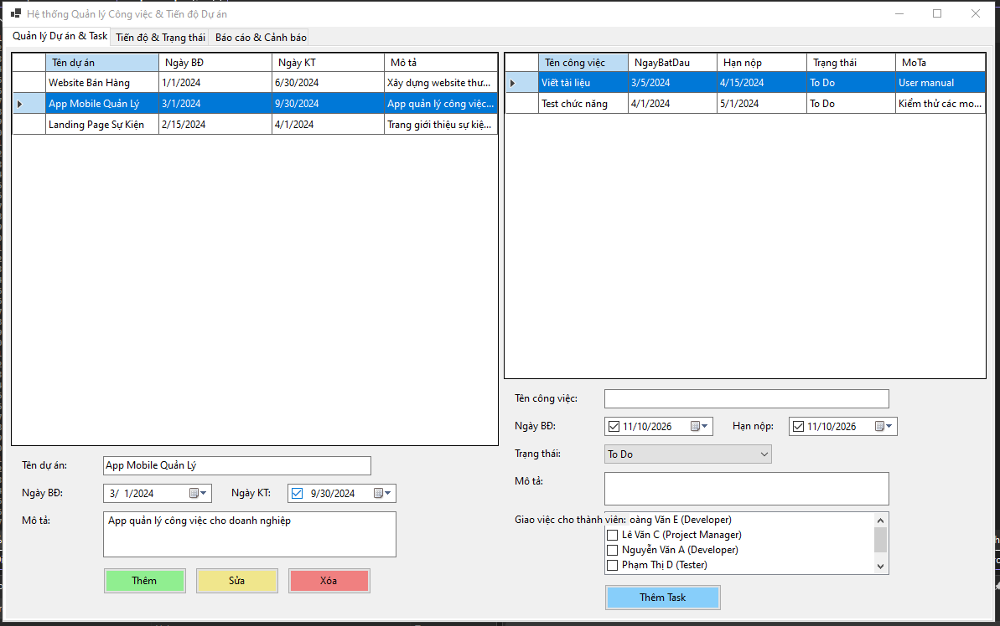

*Mô tả: Màn hình chính hiển thị danh sách Task theo Kanban với 4 trạng thái `To Do` – `In Progress` – `Review` – `Done`.*

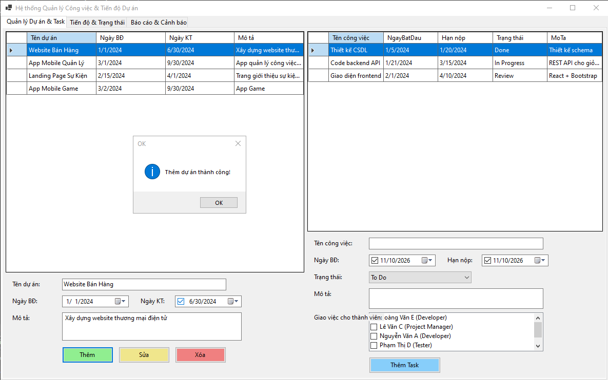

*Mô tả: Thêm Task mới vào dự án thông qua DTO/BUS/DAL.*

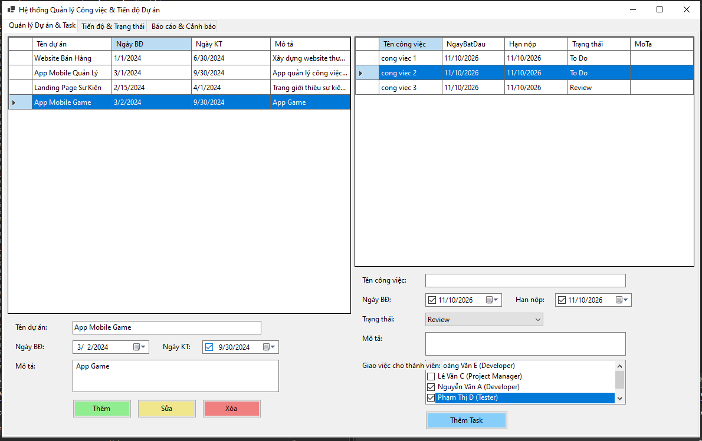

*Mô tả: Giao việc cho nhiều thành viên tham gia giải quyết Task.*

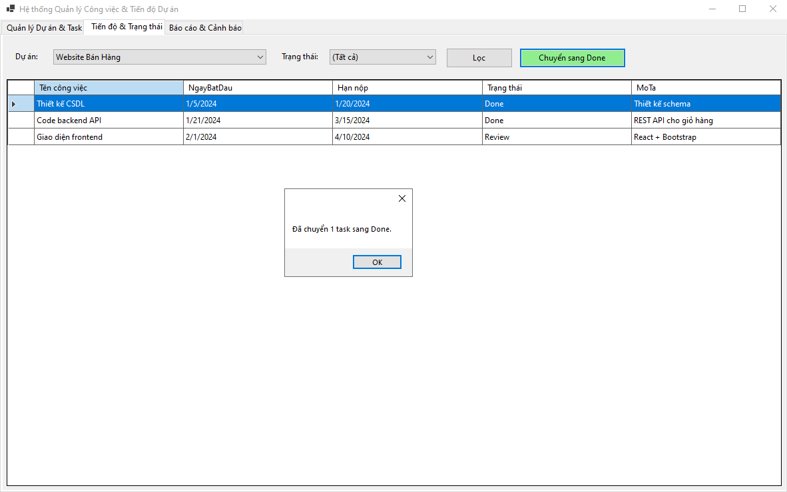

*Mô tả: Chuyển trạng thái Task từ `In Progress` sang `Done` bằng Parameterized SQL Update.*

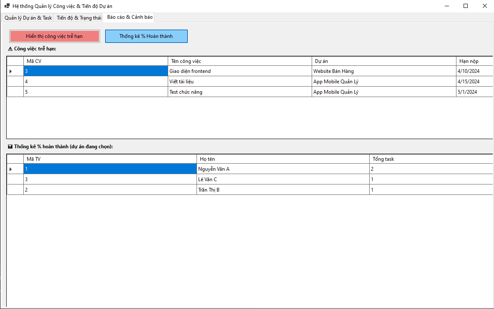

*Mô tả: Báo cáo Task quá hạn (`SqlDataReader`) và thống kê % hoàn thành từng thành viên (`ExecuteScalar` / `GROUP BY`).*

---

### 2. Bài 6.4: Hệ thống Quản lý Garage & Bảo dưỡng Xe ô tô
* **Kỹ thuật áp dụng:** `SqlParameter` tra cứu biển số xe, **`SqlTransaction`** đảm bảo tính nhất quán khi lập phiếu & trừ tồn kho phụ tùng, tính tổng tiền tự động, **Rollback** khi phụ tùng không đủ.
* **Hình ảnh minh họa Giao diện:**

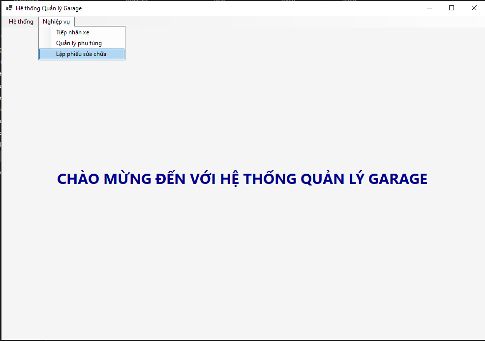

*Mô tả: Form chính MDI điều khiển các form con: Tiếp nhận xe, Lập phiếu sửa chữa, Quản lý phụ tùng, Thanh toán.*

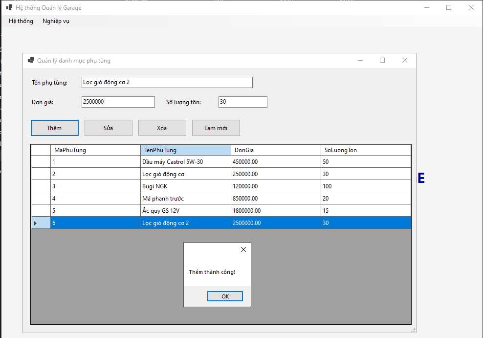

*Mô tả: Thêm mới Khách hàng & Xe với DienThoai / BienSo là Unique.*

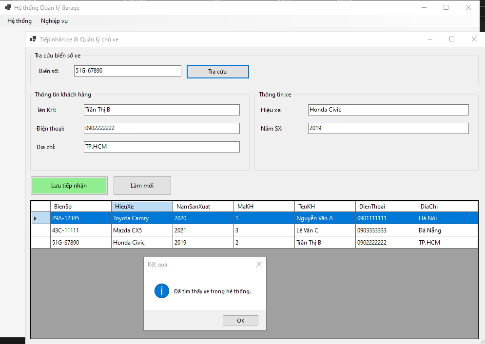

*Mô tả: Tra cứu biển số xe bằng `SqlParameter` — nếu có sẵn thì hiện thông tin, nếu mới thì chuyển sang nhập mới.*

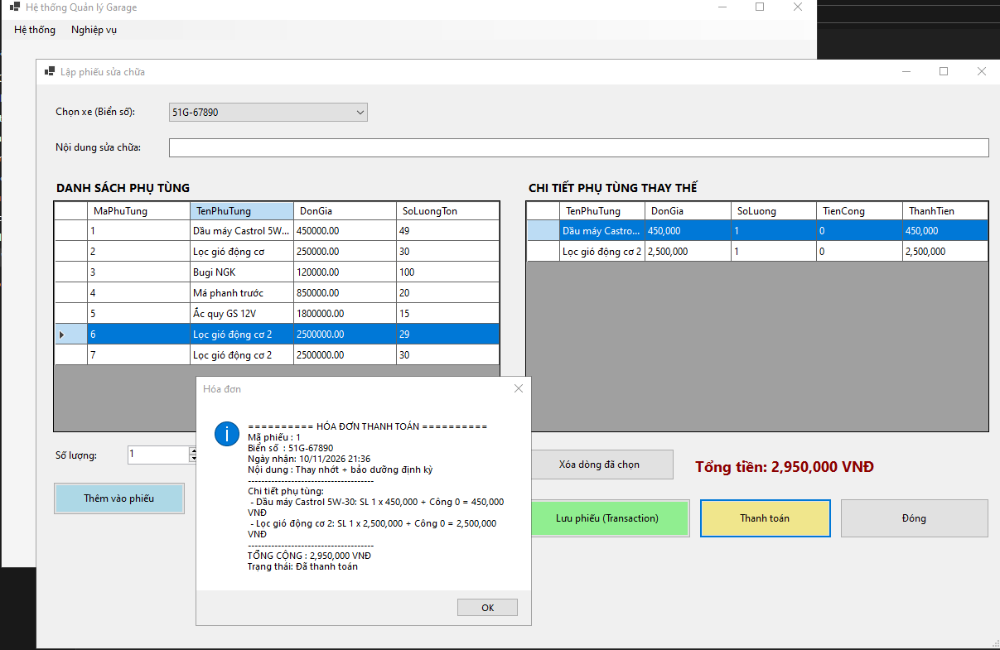

*Mô tả: Lập phiếu sửa chữa + chi tiết phụ tùng, hệ thống tự tính thành tiền và tổng cộng Thanh toán.*

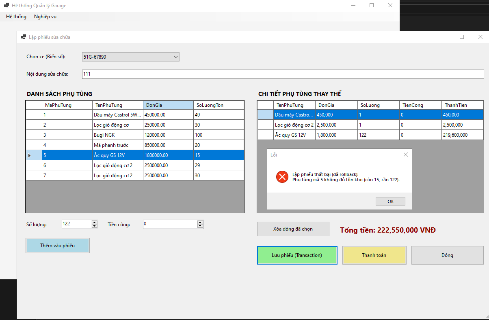

*Mô tả: Nhập số lượng phụ tùng lớn hơn tồn kho → `trans.Rollback()` và thông báo lỗi, dữ liệu không bị ghi.*

---

### 3. Bài 6.5: Hệ thống Quản lý Đặt phòng & Dịch vụ Karaoke
* **Kỹ thuật áp dụng:** **Visual Room Grid** bằng Button động (xanh/đỏ), mô hình **Disconnected** với `SqlDataAdapter + DataTable`, tính giờ tự động `GioRa − GioVao`, thanh toán bằng **`SqlTransaction`** (cập nhật HoaDon + trừ TonKho + đổi trạng thái phòng).
* **Hình ảnh minh họa Giao diện:**

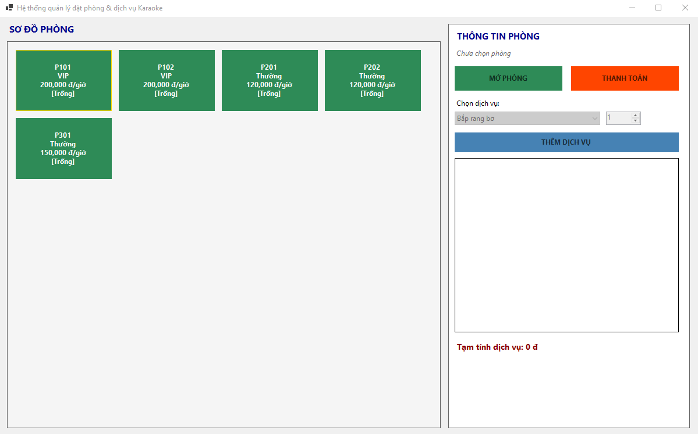

*Mô tả: Sơ đồ phòng hát dạng Button động — phòng "Trống" màu xanh, phòng "Đang hát" màu đỏ.*

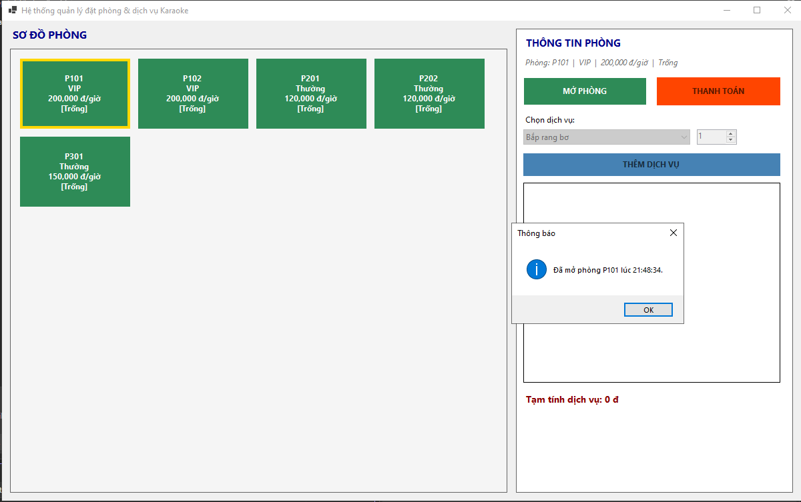

*Mô tả: Mở phòng → tạo HoaDon mới với `GioVao = GetDate()`, đổi `TrangThai` phòng sang "Đang hát".*

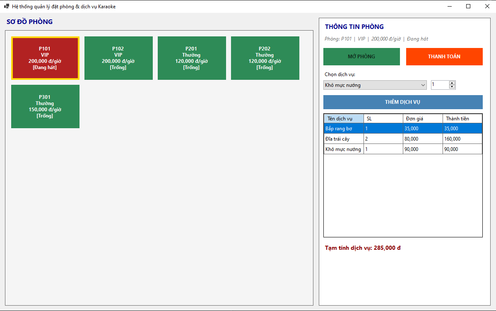

*Mô tả: Gọi dịch vụ / đồ uống — hiển thị danh sách dịch vụ đã đặt bằng `SqlDataAdapter + DataTable`.*

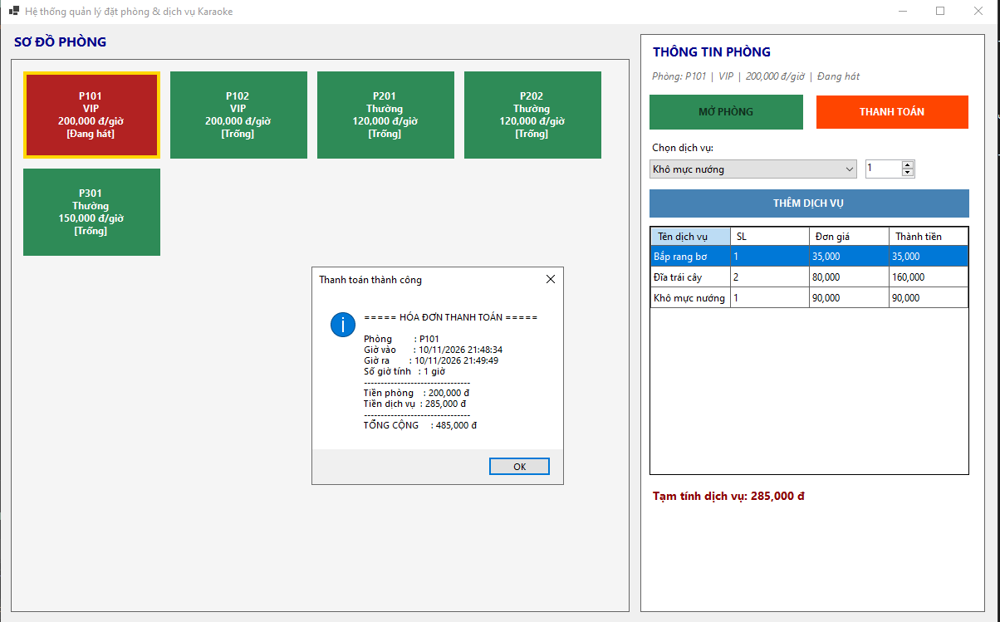

*Mô tả: Thanh toán — tự tính `TongTienPhong = SoGio × GiaTheoGio`, `TongTienDichVu = Σ(SoLuong × DonGia)`, dùng `SqlTransaction` để commit.*

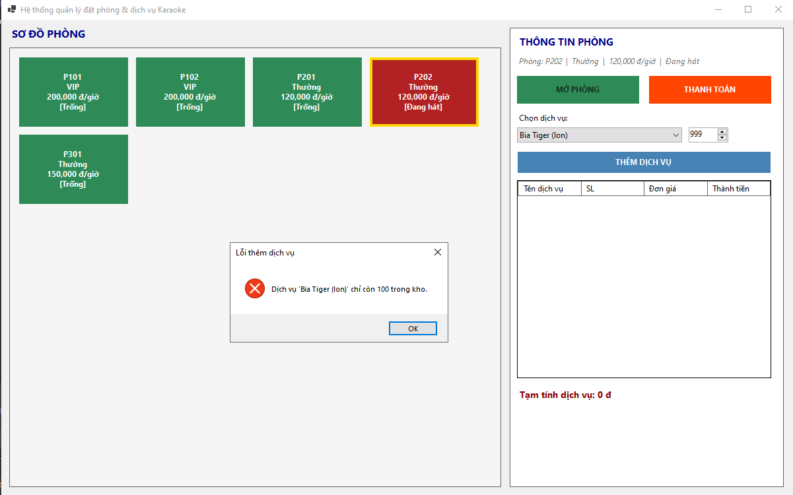

*Mô tả: Số lượng dịch vụ vượt tồn kho → `trans.Rollback()`, phòng vẫn "Đang hát", hóa đơn chưa thanh toán.*

---

## IV. HƯỚNG DẪN CÀI ĐẶT & CHẠY DỰ ÁN

1. Clone Repository về máy:

```bash
git clone https://github.com/datdct24810320215-cloud/LTNET-BaiTap_63_64_65_-_24810320215_DangCaoThanhDat.git